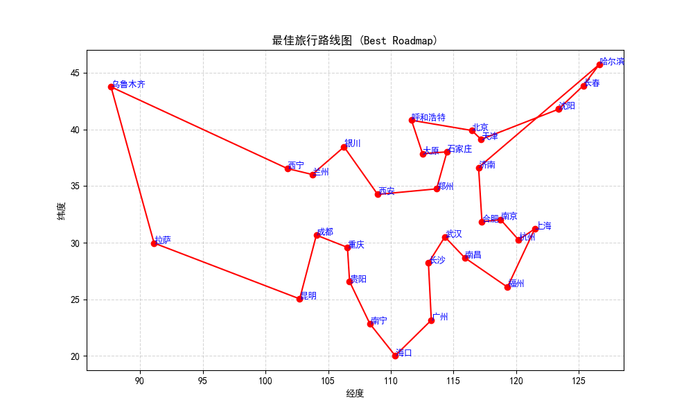
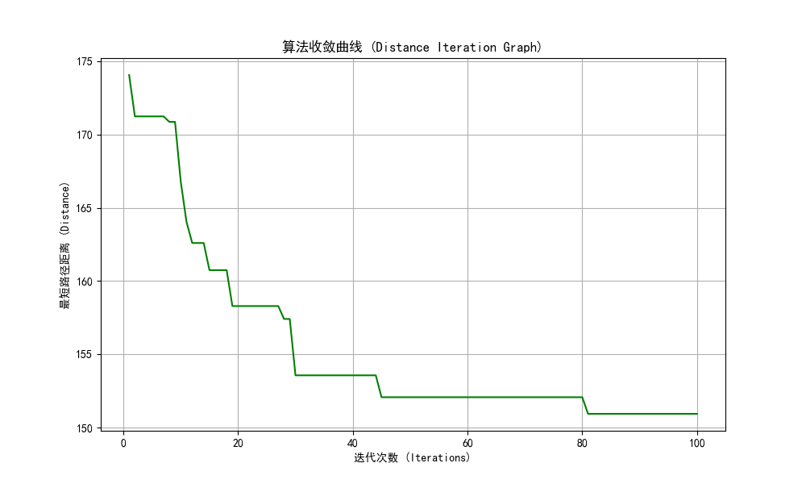

# Ant Colony Optimization for TSP

使用蚁群算法（Ant Colony Optimization, ACO）求解旅行商问题（Traveling Salesman Problem, TSP）的 Python 实现。

程序读取城市坐标，计算城市间距离矩阵，通过信息素和启发式因子构造路径，并在多轮迭代后输出最优路线与收敛曲线。

## 预览





## 算法流程

1. 从 `data.txt` 读取城市名称和二维坐标。
2. 计算城市两两之间的欧氏距离。
3. 每只蚂蚁从随机城市出发，根据以下概率选择下一个城市：

   \[
   P_{ij} \propto \tau_{ij}^{\alpha}\eta_{ij}^{\beta}
   \]

   其中 `tau` 是信息素，`eta = 1 / distance` 是启发式因子。
4. 使用轮盘赌完成路径选择。
5. 根据每只蚂蚁的路径长度更新信息素，并执行信息素挥发。
6. 保存每一轮的历史最优路径，最后绘制路线图和收敛曲线。

## 数据格式

`data.txt` 每行一个城市：

```text
城市名,经度,纬度
北京,116.46,39.92
天津,117.2,39.13
```

## 运行

```powershell
python -m venv .venv
.\.venv\Scripts\Activate.ps1
pip install -r requirements.txt
python ant_colony_tsp.py
```

Linux/macOS：

```bash
python3 -m venv .venv
source .venv/bin/activate
pip install -r requirements.txt
python ant_colony_tsp.py
```

程序会弹出两张图：

- 最优旅行路线；
- 迭代过程中历史最优距离的收敛曲线。

## 默认参数

| 参数 | 默认值 | 含义 |
|---|---:|---|
| `AntCount` | 50 | 蚂蚁数量 |
| `alpha` | 1 | 信息素重要程度 |
| `beta` | 5 | 距离启发式重要程度 |
| `rho` | 0.001 | 信息素挥发率 |
| `Q` | 1 | 信息素强度常数 |
| `MAX_iter` | 100 | 最大迭代次数 |

## 项目结构

```text
ant-colony-tsp/
├─ ant_colony_tsp.py
├─ data.txt
├─ requirements.txt
├─ docs/images/
└─ README.md
```

## 说明

这是课程实践项目。城市坐标用于演示算法，不用于真实导航距离计算。随机种子已固定，便于复现实验结果；不同参数仍可能得到不同的局部最优路径。
